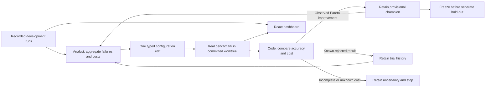
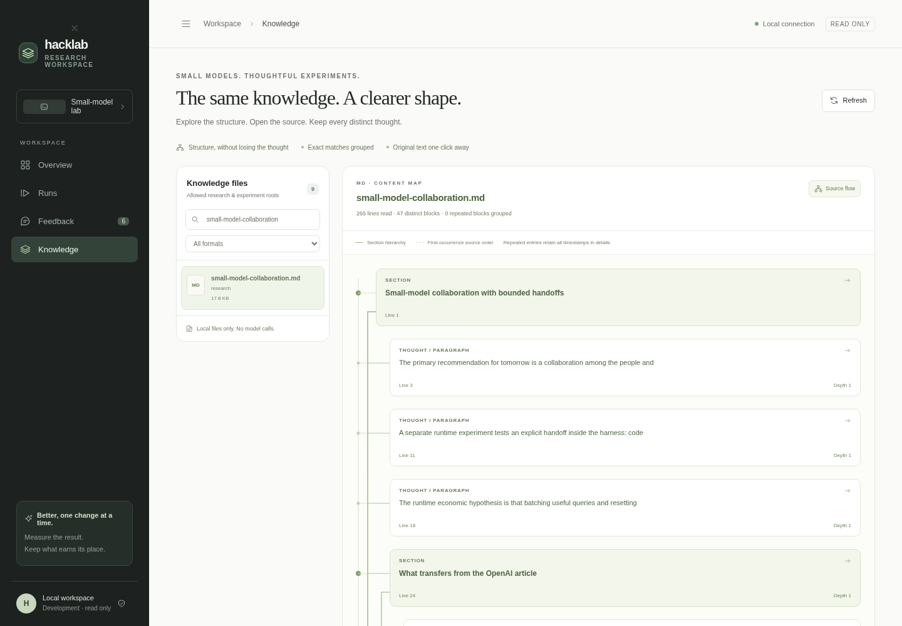
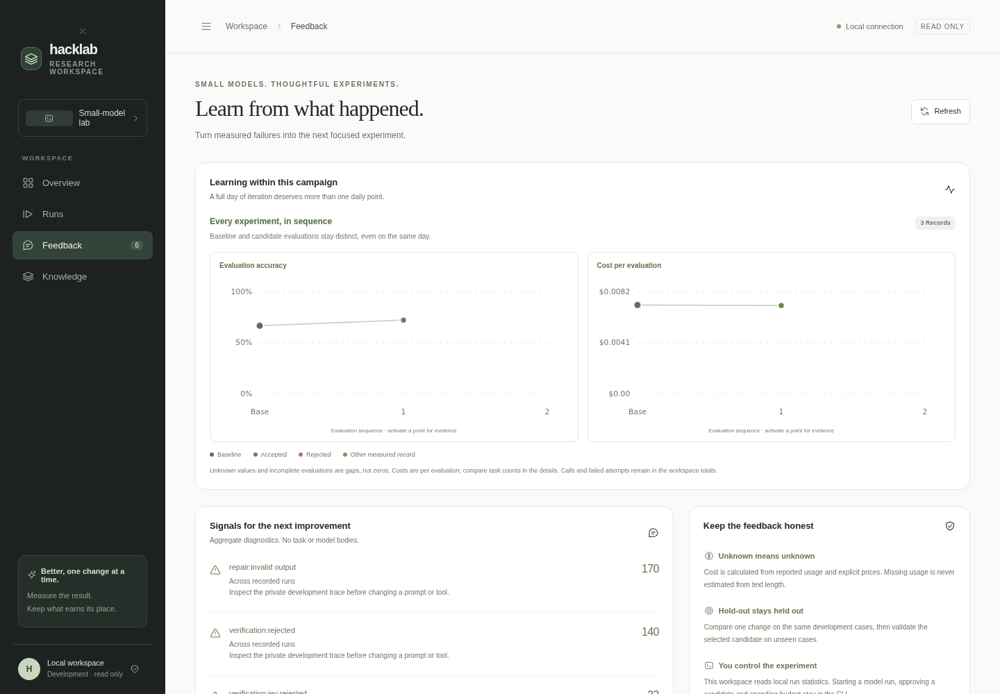
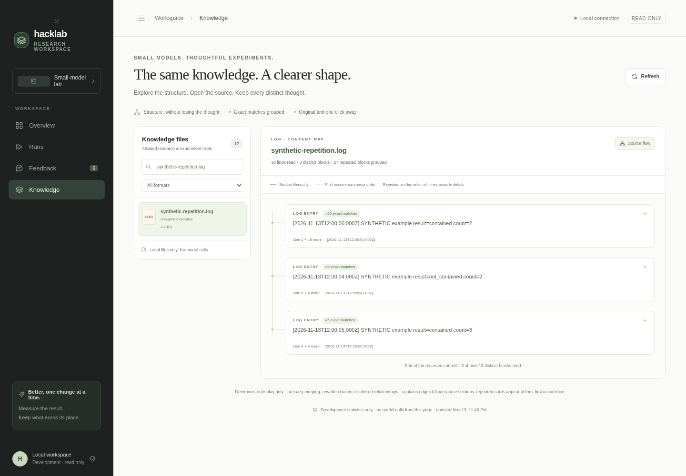

# Small-model collaboration with bounded handoffs

The primary recommendation for tomorrow is a collaboration among the people and
coding assistants building the harness: Scout the failures, let an Analyst propose
one concrete candidate, have a Validator run it against real cases, then ask a
Reviewer to inspect the evidence and constraints. The aim is a cheaper, more
reliable submitted program without requiring extra model roles during every
competition task. Coding assistants build and review; they never answer competition
tasks or become tools available to the submitted agent.

A separate runtime experiment tests an explicit handoff inside the harness: code
scouts the data, an Analyst requests a small batch of read-only computations, a
Responder receives a fresh evidence packet, and code validates the final answer
and actions. Both model roles use the same configured model; at the event that
must be the organizer-provided model. This remains an optional candidate alongside
the existing loop.

The runtime economic hypothesis is that batching useful queries and resetting
conversational context can save more serial planning turns than the extra
Responder call costs. Easy tasks and tasks already covered by playbooks can favor
the existing path. A benchmark must decide; role names alone do not establish
better accuracy, independent review, or savings.

## What transfers from the OpenAI article

Source: [A thousand fewer paths to root](https://openai.com/index/a-thousand-fewer-paths-to-root/).
The analysis below uses the article text supplied by the user. Independent retrieval
through the research service was blocked, so this is not an independently fetched
copy. The numerical findings describe that article's kernel-research setting.

| Article finding or method | Transfer to this harness | Limit of the analogy |
| --- | --- | --- |
| Scouts selected 5,034 audit targets, about 2.8 million lines or roughly 7% of the code, for $3,426. | In development, scout traces and task types before assigning implementation work; in the runtime experiment, build an inventory and request narrow computations. | We have not measured a comparable percentage of evidence reduction, and incomplete retrieval can hide decisive evidence. |
| Specialized stages divide exploration, analysis and verification. | Give development agents separate research, implementation, measurement and review deliverables; test explicit Analyst and Responder contracts at runtime separately. | Reusing one model in separate contexts does not create independent expertise. |
| An early run found 20 of 200 successful exploits used a different zero-day; an independent check was added to confirm exploitation of the assigned vulnerability. | Keep the original task, observations, proposed conclusions and final validation separate; require evidence IDs and guarded actions. | A valid citation proves provenance, not that a conclusion is true or answers the assigned question. |
| Reported average exploitation cost was $3,922 per unsuccessful case (69 cases), versus about $360 per successful case (1,169 cases); a give-up condition after an hour without progress was discussed. | Bound development investigations and runtime queries, rounds, retries and total usage; permit abstention when the evidence remains insufficient. | These historical per-case averages are not our tariff and do not measure the effect of an implemented stopping rule. |
| A skill raised the weaker model from 76.2% to 88.9%, versus 92.1% to 93.6% for the stronger model. | Give a role a short, task-specific contract with real tool and schema names; test whether the weaker model can execute it reliably. | This does not predict our model's gain or justify expanding every prompt. |

The article's API-cost accounting was not an optimized deployment budget. Its
results do not identify a training recipe for our model, establish the cheapest
possible system, or establish actual bounty revenue. Kernel vulnerability research
and the competition's investigation tasks have different verification environments.
The transferable idea is a staged collaboration with explicit evidence and bounded
work, rather than a claim that the same model capability has been reproduced.

## Primary application: development collaboration

Use bounded deliverables and explicit ownership before adding runtime calls:

| Development role | Input | Deliverable and handoff |
| --- | --- | --- |
| Scout | Organizer rules, actual schemas, baseline failures and private traces. | A short list of recurring failure types and their decisive evidence; no speculative prompt expansion. |
| Analyst / implementer | One failure type and the current tool contracts. | One candidate: deterministic playbook, corrected tool, compact task skill, or optional workflow change, in an isolated branch/worktree. |
| Validator / measurer | Committed candidate and baseline, equal settings and development cases. | Passing required checks, paired live benchmark, usage receipts, failure analysis, then a separate unseen hold-out run after selection. |
| Reviewer / integrator | Diff, source evidence, results and starter-kit contracts. | Check the original objective, action boundaries, fallback behavior, cost claims and container integration; accept or reject the candidate from evidence. |

The Validator and Reviewer return evidence to the implementer, not a new
unbounded subtask tree. Set a spending and time limit for each experiment, stop
after a candidate's deciding measurement, and record failed ideas so another agent
does not repeat them. A second model's agreement is not a substitute for an actual
test or benchmark. Keep reference answers out of runtime prompts and private traces
out of published artifacts.

This work divides research, implementation and verification/review tasks among
development agents. Their collaboration changes the harness source and evidence;
it does not expose a coding assistant, foreign model or internet tool to the
submitted agent. The source diff and executed checks below establish the actual
runtime behavior, while measured results determine what should be submitted.

## Implemented development feedback system

The [feedback workspace guide](../feedback-loop.md) contains the executable
commands and operating limits. This is configuration search, not model-weight
training or unrestricted source-code generation.



The Analyst uses the configured small model and sees only aggregate measurements
and safe configuration history. It can edit six controls: workflow, initial result
count, inventory, document-preload threshold, list-preview length and observation
length. It cannot change providers, models, prices, guards, budgets or source.
Every observed proposal, retry and failed provider attempt retains its usage
receipt; a possibly unobserved request is marked explicitly uncertain.
Unknown costs stop the campaign; an interrupted measurement cannot become a free
successful trial. Promotion remains provisional: small repeated measurements can
still accept noise, and a separate hold-out is needed before claiming generalization.

The Bun/React/TypeScript 7 dashboard reads the shared SQLite database without
starting model calls. It shows per-trial accuracy and cost, accepted and rejected
changes, grading failures, request stages and unknown-cost gaps. The Knowledge
view converts bounded local text into a source graph: exact repeats share a node;
each retained occurrence, timestamp, value and negation remains inspectable within
the stated limits, except explicitly redacted credentials. This does
not claim semantic equivalence between differently worded paragraphs. Sources
stay local, with credential redaction and visible read/graph limits.



## Optional runtime candidate

```text
Task
  -> existing deterministic playbooks, when their preconditions hold
  -> code Scout: document inventory and guarded briefing
  -> Analyst: typed batch of read-only queries
  -> code: validate queries, execute existing tools, record rows in Ledger
  -> fresh Responder: original task + queries + guarded results
       -> final answer
       -> or bounded request for another evidence round
  -> existing code validator and action guard
  -> Answer, including bounded failure or abstention
```

The Scout is ordinary code. It reports the real files, sizes and column names so
the model does not spend a turn discovering them. Existing playbooks retain first
refusal: arithmetic, decoding, graph traversal and exhaustive list construction
belong in code whenever their assumptions can be checked.

The Analyst's product is a typed query plan, not an answer or a free-form report.
Only the configured read-only tools can execute in this stage. Code validates the
whole batch against the tool registry and the remaining task allowance. A tool
marked `mutating=True` must never enter the batch. Independent queries may be
planned together, but the executor remains bounded and uses the existing tool
contracts; a dependent query waits for a later evidence round.

Every returned row goes through `Ledger.add`, retaining evidence IDs, injection
flags and secret placeholders. Results remain data even if a document claims to be
a system message, a role handoff, or a request to run another tool. The original
task and owner-maintained code define the permitted work. A model's plan cannot
authorize a new tool, endpoint, action type or target.

The Responder starts with a fresh conversation containing the original task, the
queries and their guarded outputs. It does not inherit an Analyst narrative or a
purported final answer. This makes the evidence handoff inspectable and avoids
paying to resend a long planning conversation. The Responder either supplies the
normal typed final result or requests a bounded revision when evidence is missing.
Both roles can still make correlated mistakes; this is a context separation, not
an independent truth oracle.

Final citations and containment actions pass the existing code checks. The Analyst
cannot execute containment. The Responder's proposed actions still require an
allowed action type, an unprotected target and acceptable grounding. Existing
registered mutation tools remain under their action guard. Jev stays optional;
neither a missing route nor an unavailable optional judge may fail the task.

All stages share one task budget. Queries across rounds count toward `max_steps`;
provider attempts, including retries and errors, count toward the same call, token,
cost and wall-time limits. The candidate defaults to at most two evidence rounds,
with a finite configured bound. Fresh role contexts must not reset those counters.
Provider or tool failure, malformed output and exhaustion must still lead to an
`Answer`. There are no recursive agents, additional runtime models, internet tools
or cross-task memory.

## Evidence from related primary research

These papers establish useful mechanisms and failure modes. Their datasets,
models and prices do not establish our competition result.

**PAL: Program-aided Language Models** ([paper](https://arxiv.org/html/2211.10435),
Tables 1–2 and Section 6) separates problem interpretation from computation.
With the same Codex backend, GSM8K accuracy was 65.6% for chain-of-thought and 72.0%
for PAL; on GSM-hard it was 23.1% versus 61.2%. A Python-formatted prompt that made
the model simulate execution achieved only 23.2% on GSM8K. The interpreter did the
useful work. Weaker code models retained relative gains, but a natural-language
model with insufficient coding ability did worse with PAL than chain-of-thought.
Replacing meaningful variable names also damaged symbolic-task accuracy. For this
harness, the appropriate transfer is bounded existing tools with real field names,
not executing arbitrary Python generated from attacker-written evidence.

**ReAct: Synergizing Reasoning and Acting in Language Models**
([paper](https://arxiv.org/html/2210.03629), Section 3.3) gives a particularly relevant
warning. Prompted ReAct performed worst among the four tested prompting methods on
PaLM-8B and PaLM-62B, attributed to the difficulty of learning reasoning and acting
from examples. Fine-tuning on 3,000 correct trajectories changed that result, but
training is outside this experiment. The paper also documents repetitive actions
and uninformative search as failure modes. More than seven steps for HotpotQA or
five for FEVER did not improve that study's ReAct performance. These are reasons to
measure a small-model handoff and stop rule, not copy a large-model reasoning loop.

**Agentless: Demystifying LLM-based Software Engineering Agents**
([paper](https://arxiv.org/html/2407.01489v2), Sections 5.1–5.2) uses fixed
localization, repair and validation stages. In its localization ablation, concise
file skeletons retained the ground-truth location in 58.33% of issues at a reported
$0.02 per issue, versus 53.67% and $0.15 for complete files. In patch selection,
majority voting solved 77/300 issues; adding regression tests raised this to 81,
and adding reproduction tests to 96. Those are component-level measurements in
that study, not prices or gains for our harness.

Agentless also illustrates the cost of verification errors: 213 generated tests
reproduced the original issue, but only 94 also recognized the ground-truth repair.
Its complete setup used GPT-4o, an embedding model, 40 patch samples and 40
reproduction-test samples per issue. This repository forbids adding that embedding
model at runtime, and copying the sampling volume would contradict an unmeasured
claim of cheap operation. Transfer concise representations and checked handoffs;
do not import that architecture or accept a generated verifier on trust.

## Measurement plan and decision rule

Compare the existing loop with the role workflow using the same model, model
settings, tools, limits and development cases. Keep the workflow switch as the
single experimental change. Read failure traces before revising either role or
its contract. Run a separate, previously unseen seed or case file after selecting
the candidate, and do not tune on that file.

The report must include exact-match task accuracy, failures by category, action
precision and recall where applicable, provider attempts, reported input/output
tokens, estimated cost and latency. Unknown usage or missing prices remain unknown;
cache replays retain their original usage and must be identified separately from
new live spending. Report every role call and unsuccessful attempt. No reference
answers may enter a prompt, tool result or replay-cache key/body.

Use `hacklab benchmark`, `hacklab compare` and `hacklab failures` on the paired
runs. A handoff can help difficult multi-query tasks while adding overhead to an
easy one-call task; show both rather than hiding the extra call in an average.
An offline mock verifies protocol behavior, never actual-model accuracy. A zero-call
playbook result verifies deterministic coverage, never small-model capability.
Because the organizers' combined-score formula is unknown, report accuracy and
cost separately and avoid inventing a combined score.

## Applying the collaboration at the event

The development team can use the same explicit handoff discipline. The Integrator
owns the starter-kit task/answer mapping, actual mutation-tool contracts, the
container and endpoint probe. The Analyst owns real dataset schemas and short
playbooks whose assumptions are checked. The workflow owner owns the Analyst and
Responder contracts, including which tools are available and what a revision can
request. The Measurer owns development/hold-out separation, shared spending and
the comparison report. Keep overlapping changes in separate branches or worktrees.

At the opening, confirm the scoring rule, prices, available model routes, action
types, protected targets, task limits and permitted parallelism. Replace rehearsal
file and column guesses with the actual starter-kit contracts. First produce a
valid end-to-end submission, then adapt one component at a time. Coding assistants
may build and review the solution; they must never answer competition tasks.
Choose the submission candidate from measured held-out accuracy and cost, retain
the simpler loop if the extra handoff does not pay, and freeze before the deadline.

## Benchmark results

The first runtime experiment used the nine synthetic rehearsal tasks from seed
41, with no playbooks, Jev or replay cache. Both used the configured Granite 4.2
8B endpoint, temperature 0, low reasoning, and the same documents and questions.
These are exploratory development measurements, before integrating subsequent
upstream hardening. They are not measurements of organizer data or a final model.

| Workflow and source | Exact tasks | Requests | Input / output tokens | Estimated API cost | Task p50 / p95 |
| --- | ---: | ---: | ---: | ---: | ---: |
| Existing loop, `e8d2165` | 7 / 9 | 29 | 49,509 / 3,136 | $0.00344094 | 3,381 / 6,497 ms |
| Analyst / Responder, `e0aa4ae` | 5 / 9 | 19 | 28,962 / 3,801 | $0.00230787 | 4,295 / 6,887 ms |

The pipeline made 10 Analyst attempts and 9 Responder attempts. The loop made 29
ordinary attempts. On the one containment task, action precision/recall were
0.9130/0.8750 for the loop and 0.9091/0.8333 for the pipeline; neither solved the
complete task. [Recorded configuration and stage metadata](results/initial-provenance.json)
identify the configured route and temperatures. Historical receipts did not retain
separate requested/reported model identifiers; configured reasoning is evidenced
by the committed TOML, not an asserted response field.

The role workflow saved 32.9% of estimated API cost but lost two exact tasks.
It is **rejected as a default improvement**. This is the sort of tradeoff the
development reviewer must preserve and display instead of equating fewer calls
with better performance. One run per workflow is too small to establish a stable
effect size; backend nondeterminism and the different source revisions are limits.
The baseline loop's request construction was unchanged by the opt-in integration.

The pipeline trace showed incomplete decoding queries and a Responder copying a
list preview despite having its full result ID. The ordinary loop also confused
new-token targets with the credentials used for token creation. Separate model
contexts did not independently establish correctness. These failures support
development-time feedback and explicit tools, rather than an always-on swarm.

Body-free benchmark receipts: [loop](results/initial-loop.json) and
[pipeline](results/initial-pipeline.json). Every request had reported usage;
there were no cache hits or unknown-cost calls. Prices were the repository's
configured estimates ($0.06 / million input, $0.15 / million output), not an
invoice or the event tariff. Seed 104729 was reserved before candidate tuning
for final validation; its observations must not enter the Analyst's feedback.

## Autonomous campaign: observed result and stop

The integrated campaign used source `8314d80`, the current OpenRouter profile,
the same seed 41 development set, and two repetitions per evaluation. The newer
profile and upstream hardening differ from the exploratory experiment above;
compare candidates within each experiment, not across those source revisions.

| Measurement | Exact tasks | Requests | Input / output tokens | Estimated API cost | Task p50 / p95 |
| --- | ---: | ---: | ---: | ---: | ---: |
| Fresh baseline | 12 / 18 | 56 | 93,931 / 10,084 | $0.00714846 | 6,213 / 48,323 ms |
| First proposed candidate | 13 / 18 | 59 | 100,533 / 7,208 | $0.00711318 | 6,210 / 14,630 ms |

The Analyst proposed `agent.preload_documents_under: 40 -> 20`. The deterministic
reviewer accepted the observed +1 exact task and 0.49% lower evaluation cost.
However, this threshold changes no preload selection on this seed: the runbook
has 11 lines, the token table 47 rows, and both logs exceed 40 units. This is
**not evidence that the edit improved the harness**. Backend variation can pass
this simple promotion rule. Check that a candidate affects real inputs and use
independent confirmation before choosing a submission.

The next candidate set `agent.preload_results` to zero. Its measurement did not
complete. The launcher exited 143 after 489.8 seconds; the source of that signal
was not established. The final recorded provider attempt was a transport error
without usage or priceable cost. Known live campaign spending was $0.02126484,
including Analyst calls and work on the incomplete candidate; the complete cost
is unknown. No provider receipt or token count was invented for a possibly
unobserved request. Paid runs stopped, so the reserved hold-out was not generated
or evaluated and no generalization gain is claimed. The [overview screenshot](images/overview.png)
shows the unknown total beside its known subtotal.

The original unfinished database records were preserved privately, then the
owned campaign was explicitly marked unknown-cost. Offline investigation
reproduced signal reentry interrupting cleanup and rolling back a terminal
transaction; it did not establish that this caused the live interruption.
The final implementation hardens signal handling and lets the parent reconcile
its own stopped worker's unfinished records. Those repairs are verified offline;
they were not retested with further paid requests.

Body-free measurements: [baseline](results/feedback-baseline.json),
[first candidate](results/feedback-candidate-1.json) and
[campaign receipt](results/feedback-campaign.json). Private task traces, database
files, credentials and response bodies are excluded from this report.



## Dashboard performance

The [synthetic HTTP benchmark](results/dashboard-api.json) ran committed source
`caade49` with Bun 1.4.4: 10,000 runs, 100,000 provider receipts, 100 campaigns,
1,000 trials and an incomplete measurement record. Each endpoint had 10 warmups
and 200 sequential samples. The workstation was shared; CPU, SQLite and OS caches
were not isolated or flushed. "First" below means the first request to that
endpoint, not a cold disk or cold browser.

| API view | First request | Warm p50 | Warm p95 |
| --- | ---: | ---: | ---: |
| Overview, with a two-second aggregate cache | 121.72 ms | 0.064 ms | 0.093 ms |
| 50 runs at offset 5,000 | 13.18 ms | 11.79 ms | 13.66 ms |
| Campaign list | 1.73 ms | 0.909 ms | 1.185 ms |
| Campaign detail | 0.85 ms | 0.184 ms | 0.247 ms |
| State-file inventory | 0.27 ms | 0.091 ms | 0.121 ms |
| Graph of a roughly 200 KiB log | 7.03 ms | 4.15 ms | 5.17 ms |

The timestamped log contained 2,925 entries and six distinct messages. The graph
retained six visual nodes and all 2,925 occurrences, a 487.5-fold reduction in
repeated nodes. The benchmark reconstructed every source line, including all
timestamps, numbers and negations, and verified no truncation. The decoded JSON
body was 161,415 bytes versus 204,748 source bytes; headers, transport overhead
and HTTP compression were not measured. This fixture does not establish semantic
compression for arbitrary prose, browser rendering speed or concurrent capacity.

The [production build receipt](results/dashboard-assets.json) records 264,081
JavaScript bytes (82,246 with offline gzip) and 30,234 CSS bytes (7,344 gzip).
Only assets referenced by the newly built index were counted. These are build
sizes, not measured network transfer or page-render timings. No chart framework,
embedding model or model summarizer is needed for these graphs.

For a small inspectable example, open Knowledge and select
[`synthetic-repetition.log`](examples/synthetic-repetition.log): 30 timestamped
lines become three nodes, while `contained`, `not_contained` and counts 2 versus
3 remain separate. This is labelled synthetic throughout and is not a run result.



## Executed checks

Verification covers code revision `caade49`; the report and screenshots are added
after those measurements.

| Check | Result |
| --- | --- |
| `project-check fast` through the declared toolbox | Passed: 382 Python tests, 53 Bun tests, Ruff, TypeScript 7 and production browser build. |
| `project-check full` | Passed: Nix formatting and `nix flake check`, including VM and host-module contracts. |
| `GC_NPROCS=1 NIX_BUILD_CORES=2 bash scripts/vm-smoke` in a disposable committed worktree | Passed: 382 tests each on Python 3.15.2, 3.13.18 and 3.11.18; 53 dashboard tests; native wheels; rehearsal and container tests. |
| Container test inside the guest | Passed: nine offline playbook tasks, nine model-path answers for each existing profile, optional Jev fallback, no egress and unprivileged UID 10001. The model was a local stand-in, not a live capability measurement. |
| Chromium 157 from the existing Nix pin | Desktop 1440px and mobile 390px navigation, charts, dialogs, focus, source details, empty database and API-failure recovery passed. Nineteen screenshots were inspected; no product defect, console error or horizontal overflow was observed. |
| `dashboard/bench.ts` via `agent-tool-meter` in a disposable committed worktree | Passed: synthetic HTTP measurements and exact reconstruction of the log fixture, reported above. |

Initial normal browser launches and the first VM launch hit the shared task/thread
ceiling. Single-process Chromium and bounded GC helpers completed the checks.
One initial screenshot capture failed; the later desktop capture succeeded.
Mobile testing used a CSS viewport, without touch-device emulation. Owned browser
servers, temporary worktrees and the disposable VM were stopped and removed.

The Python source-policy scan reported zero blocking findings. Privacy-pattern
matches were inspected: existing synthetic fixtures and the new deliberately fake
private-key redaction test contain the matching strings. No real credential or
response body is published. Dependency-advisory coverage was incomplete because
the workstation has no explicit offline OSV database; this is not a clean
vulnerability scan.

The reserved hold-out, organizer data, official scoring and paid retesting of the
interruption repairs remain untested. Native macOS and Windows execution were not
tested; the optimizer explicitly requires POSIX process groups. The downstream
`nixos-host` consumer still pins this repository's `main` at `e8d2165`; advancing
that host input is outside this PR's scope.

## Research evidence receipt

Public papers were read through the isolated research service on 13 November 2026.
The identifiers below locate the retrieved evidence; the public URLs above remain
the durable citations. Search attempts were unavailable, so this is a focused
comparison of primary sources rather than a comprehensive literature search.

| Paper | Source ID | Text representation ID | Inspected evidence |
| --- | --- | --- | --- |
| PAL | `b4d2f147-8eb9-4d56-a3dc-55324f6c063f` | `f5382262-6686-4024-bd35-971eb8909e5f` | Experimental setup, Tables 1–2, Section 6 ablations and caveats. |
| ReAct | `a880a235-eb96-4781-bc82-6bb99ca3a579` | `f5de8805-284d-40ff-9ca0-a2f26865ad19` | Sections 2–4, especially Section 3.3 small-model and failure analysis. |
| Agentless | `da77cd2a-4c27-4c0b-b9bf-c7cca6e8bc62` | `7f422ba9-cf75-4d88-a29e-b7067c327ee2` | Sections 3–5, setup, reproduction-test quality and component ablations. |

The OpenAI article has no independently retrieved source receipt in this research
run. Its provenance is the user-supplied text described above.
